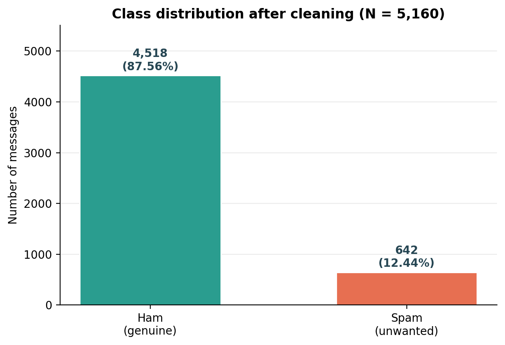
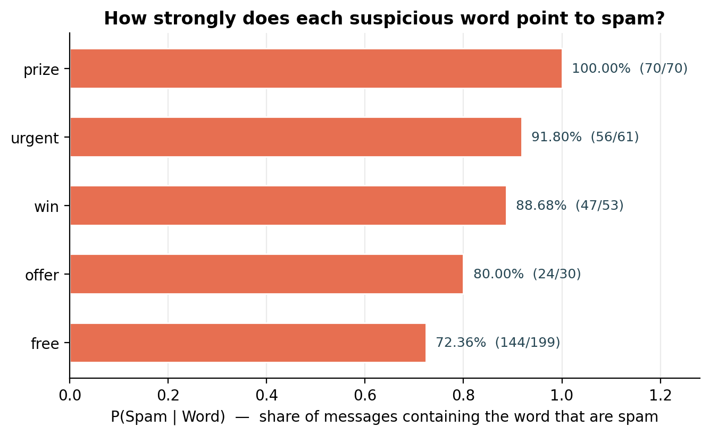
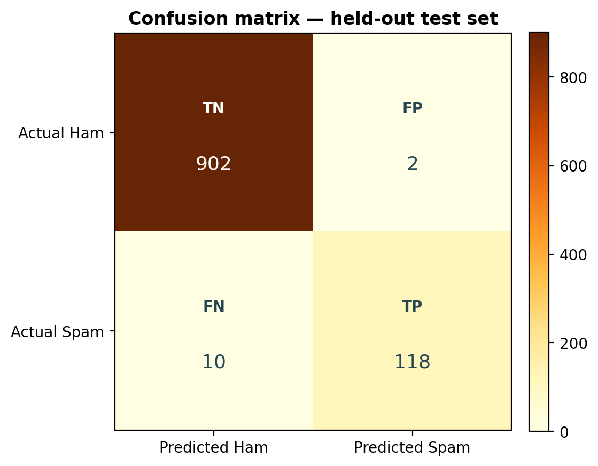

# Reading Between the Texts — Probabilistic SMS Spam Detection

**BAMAT207 – Probability and Statistics | Project Activity**

| | |
|---|---|
| **Student** | Kavin Raj SK |
| **Registration No.** | 25BCE2866 |
| **Programme** | B.Tech, CSE – Core |
| **Dataset** | [UCI SMS Spam Collection (ID 228)](https://archive.ics.uci.edu/dataset/228/sms+spam+collection) — 5,574 labelled SMS messages |

> *How far can plain probability go in separating spam from genuine (ham) texts?* This project answers that question end-to-end: empirical priors → word-level conditional probabilities → Bayes' theorem → expectation & variance → a Multinomial Naive Bayes classifier that scores any new SMS with `P(Spam | Message)` and `P(Ham | Message)`.



## Headline results (seed = 2866)

| Quantity | Result |
|---|---|
| Cleaned dataset | 5,160 unique messages — 4,518 ham / 642 spam (414 duplicates removed) |
| Priors | P(Ham) = 0.8755814 · P(Spam) = 0.1244186 |
| P(Spam \| Free) | 0.7236181 — by direct counting **and** by Bayes' theorem (identical) |
| Strongest word | P(Spam \| Prize) = 1.0000 (70/70) |
| Random variable Y (1 = spam) | E(Y) = 0.1244186 · Var(Y) = 0.1089386 · SD(Y) = 0.3300585 |
| Test accuracy | **98.84%** (1,020 / 1,032) |
| Spam precision / recall / F1 | 98.33% / 92.19% / 95.16% |
| Confusion matrix [[TN, FP], [FN, TP]] | [[902, 2], [10, 118]] |
| Activity-sheet SMS | **Spam**, P(Spam \| Message) = 0.999999641 |




## Repository contents

```
├── BAMAT207_Probabilistic_SMS_Spam_Detection_KavinRajSK_25BCE2866.pdf   ← project report (32 pp.)
├── BAMAT207_Probabilistic_SMS_Spam_Detection_KavinRajSK_25BCE2866.docx  ← editable report
├── SMS_Spam_Detection_KavinRajSK_25BCE2866.ipynb                        ← executed notebook
├── sms_spam_detection.py                                                ← one-command script
├── requirements.txt
├── data/
│   ├── sms+spam+collection.zip      ← official UCI download (offline reproducibility)
│   └── cleaned_dataset.csv          ← 5,160 de-duplicated messages with encoded labels
├── figures/                         ← class distribution, word probabilities, length, workflow, confusion matrix
├── model/                           ← fitted CountVectorizer + MultinomialNB (joblib)
└── outputs/                         ← probability tables, metrics, error lists, results.json, run transcript
```

## How to run

**Option A — script (fastest)**

```bash
pip install -r requirements.txt
python sms_spam_detection.py                  # full analysis + 5 demo predictions
python sms_spam_detection.py --interactive    # …then type your own SMS messages
```

**Option B — notebook**

Open `SMS_Spam_Detection_KavinRajSK_25BCE2866.ipynb` in Jupyter or Google Colab and run top-to-bottom. The loader tries `ucimlrepo` (dataset ID 228) first and falls back to the bundled UCI ZIP, so it works online or offline.

**Try a message:**

```python
predict_sms("Congratulations! You have won a free prize. Claim now.")
# Prediction: Spam
# P(Spam | Message) = 0.999999641
# P(Ham | Message)  = 0.000000359
```

## Method in brief

1. **Clean** — trim whitespace, remove 414 duplicate texts, encode Spam = 1 / Ham = 0.
2. **Priors** — P(Spam) = 642/5160, P(Ham) = 4518/5160.
3. **Word evidence** — whole-word counts for *free, prize, win, urgent, offer* (+ bonus *claim, call, text*); P(Spam | Word) with a lift-over-prior column; Bayes' theorem verification for *free*.
4. **Random variable** — Y ∈ {0, 1}; E(Y) = p, Var(Y) = p(1−p).
5. **Model** — stratified 80:20 split (`random_state=2866`, from my registration number), `CountVectorizer` fitted on **training text only** (vocabulary 7,597), `MultinomialNB`.
6. **Evaluate** — accuracy, precision, recall, F1, confusion matrix, classification report and a read-through of all 12 mistakes.
7. **Predict** — the activity-sheet example plus four self-designed tests (including a genuine OTP, correctly passed as ham).

## Reproducibility

Every number above is regenerated by the script/notebook with `random_state = 2866` and the cleaning policy described in the report (Appendix B lists the verified outputs and library versions). Duplicates are removed **before** splitting and the vectorizer never sees test text, so the test metrics are leakage-free.

## References

1. Almeida, T. A. & Hidalgo, J. M. G. (2011). *SMS Spam Collection* [Dataset]. UCI Machine Learning Repository. https://doi.org/10.24432/C5CC84
2. Scikit-learn documentation — `CountVectorizer`, `MultinomialNB`, model evaluation. https://scikit-learn.org/stable/

---
*Submitted in partial fulfilment of the requirements for BAMAT207 – Probability and Statistics · Kavin Raj SK (25BCE2866)*
